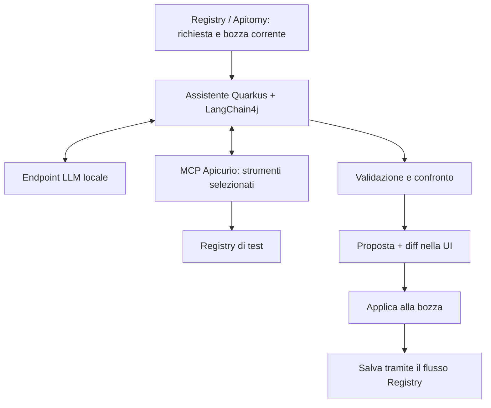

# PoC OpenAPI assistito da AI — piano per Sol e IBM Bob

Piano iniziale: 22 ottobre 2026. Aggiornamento: 23 ottobre 2026.
G4 implementato e verificato localmente nel commit `795045447`; G5 implementato nel checkout, con verifiche locali documentate sotto.
L'inventario iniziale sotto resta uno snapshot del 22 ottobre, non lo stato corrente del Mac.

**Punto di ripresa:** [servizio G4 e comandi](../examples/openapi-ai-assistant/README.md),
[evidenze G4, inclusi i replay negativi](../examples/openapi-ai-assistant/reports/g4-validation.md),
[decisioni G5 su Axiom, PatternFly e ricerca](2026-10-23-openapi-ai-g5-reuse-decisions.md).
I 28 test deterministici e gli smoke create/modify di G4 sono passati; restano la matrice
modello C1/M1/M2, la prova browser nel vero host console per G5 e le verifiche ODH. Gli smoke non sostituiscono queste prove.

## 1. Obiettivo e divisione del lavoro

Dimostrare che un modello locale può creare un documento OpenAPI e proporre modifiche a una bozza di Registry, con validazione, diff e applicazione esplicita nell'editor Apitomy. Usare componenti open source dell'ecosistema Red Hat/IBM dove utili. Verificare anche il deployment su Open Data Hub (ODH), senza confondere un test applicativo locale con una verifica della piattaforma.

- **Sol, su Linux:** implementazione, test deterministici, build, packaging e istruzioni riproducibili.
- **IBM Bob, sul Mac M1 Pro con 32 GB:** verifica dell'ambiente ARM, fattibilità del cluster, inferenza reale con Metal, prove end-to-end e misure.
- **Review finale in questa conversazione:** analisi del diff consegnato, dei risultati riproducibili e delle limitazioni. La review non è automatica: riportare qui il pacchetto di risultati.

Prima si eseguono le prove modello + MCP, poi si completa l'integrazione visuale. Lo store/catalogo degli agenti rimane un approfondimento successivo.

## 2. Fatti verificati e incertezze da risolvere

### Linux attuale

- Fedora x86_64; Intel i5-8365U, 4 core/8 thread; circa 16 GB di RAM; GPU Intel UHD 620.
- Dopo la liberazione della memoria: circa 8,5 GiB disponibili; circa 6,6 GiB di swap occupata, ma nessuno swap-in/out continuativo nei quattro intervalli di un secondo successivi al primo campione di `vmstat`. La swap occupata da sola non dimostra pressione attuale.
- Circa 155 GB di disco disponibili; `/tmp` è tmpfs: non usarlo per pesi del modello o grandi immagini.
- Registry API e UI 3.3.1 in Podman; Kind e un container della console OpenShift. **Non è un cluster OKD completo.**
- Branch `poc/console-plugin-apitomy-editor`, HEAD osservato `1356fa08a3dedd6a919550c5fe533092b4a66a37`, con modifiche tracciate e file nuovi non committati.
- Apitomy 0.2.0; PatternFly 6.6.1. Il modulo MCP nel sorgente appartiene alla linea 3.4.0-SNAPSHOT: non presumere compatibilità completa con il Registry 3.3.1 in esecuzione.

### Mac previsto

Le sole informazioni confermate dall'utente sono M1 Pro e 32 GB di RAM. Bob deve misurare memoria disponibile, disco, versione macOS, risorse assegnabili alle VM e architettura delle immagini. Non è ancora stato eseguito un test su quel computer.

### ODH sul Mac: conclusione precisa

**Non è dimostrato impossibile; non è ancora una configurazione validata.**

1. CRC documenta Apple Silicon per il preset `openshift`, ma non per `okd`. Il solo cluster CRC ha una base minima di 10,5 GB di RAM; ODH e il modello richiedono risorse aggiuntive. [CRC: installazione](https://crc.dev/docs/installing/), [preset](https://crc.dev/docs/using/).
2. La documentazione corrente di OKD single-node include ARM64. Questo non certifica una specifica VM Apple Silicon, un bundle CRC o l'intera combinazione ODH/Playground. Per il percorso comunitario serve verificare release, installer, immagine di boot, virtualizzazione e rete. [OKD single-node](https://docs.okd.io/latest/installing/installing_sno/install-sno-preparing-to-install-sno.html).
3. OpenShift AI include configurazioni ARM e una matrice per componente. È un'indicazione utile, ma non certifica le immagini upstream ODH scelte per il PoC. La matrice corrente distingue anche Llama Stack e OGX fra release: non assemblare componenti di generazioni diverse. [Matrice ufficiale](https://access.redhat.com/articles/rhoai-supported-configs).
4. Il README corrente dell'operatore ODH richiede OpenShift 4.19+ per il percorso descritto. La presenza di funzionalità XKS non dimostra che l'intero Playground sia installabile su Kind. La documentazione storica ODH è archiviata da marzo 2026: confrontare sempre istruzioni e CRD della release scelta. [Operatore ODH](https://github.com/opendatahub-io/opendatahub-operator), [avviso archivio](https://opendatahub.io/docs/installing-open-data-hub/).

Il piano mantiene quindi **due risultati distinti**: PoC applicativo locale e PoC su piattaforma ODH. Un risultato locale positivo non chiude il secondo.

## 3. Architettura da realizzare



Sul Mac eseguire inizialmente il server LLM **nativamente su macOS con Metal**, separato dalla VM/container dei servizi. Non assumere che una GPU Apple diventi disponibile come una GPU CUDA dentro una VM Linux.

Se ODH supera i controlli iniziali, aggiungere una seconda entrata: Playground ODH → runtime agentico della release selezionata → endpoint modello e MCP HTTP. Il collegamento a un endpoint modello esterno al cluster va verificato nella specifica release del Playground. Se manca, riportare il limite; una chiamata HTTP da un pod da sola non equivale all'integrazione del Playground.

Per il percorso locale usare MCP **stdio**, che evita un server HTTP e un identity provider aggiuntivi durante la prima prova. Per ODH usare HTTP con autenticazione conforme alla versione MCP scelta.

## 4. G0 — Base riproducibile e trasferimento Linux → Mac

**Sol:**

1. Leggere `AGENTS.md`, `DEVELOPING.md`, `console-plugin/APITOMY-POC.md` e le regole pertinenti in `.claude/rules/`.
2. Salvare inventario di branch, HEAD, diff e file non tracciati prima di modificare. Non fare reset, stash distruttivi o aggiornamenti dell'ambiente preesistente.
3. Preparare uno snapshot trasferibile comprendente sia i file modificati sia i nuovi file Apitomy. `git diff` da solo non include questi ultimi. Usare un commit locale firmato DCO se autorizzato oppure un archivio con elenco file e SHA-256; nessun push necessario.
4. Escludere credenziali, kubeconfig, `.env`, cache, `node_modules`, immagini e dati personali. Allegare solo fixture sintetiche.
5. Creare `versions.lock.yaml` con SHA dei sorgenti, lockfile npm, versioni JVM/Node/Maven, immagini con digest, architetture disponibili, modello/revisione/quantizzazione/checksum, runtime LLM e prompt versionati. Riempire i campi solo dopo verifica.
6. Eseguire la baseline frontend descritta in `APITOMY-POC.md`; registrare esiti effettivi. Il documento precedente riporta 269 test passati: è un dato storico, non un risultato di questa attività.

**Bob:**

1. Verificare checksum dello snapshot e lockfile prima dell'installazione.
2. Rilevare `uname -m`, `sw_vers`, memoria/pressione memoria, disco libero, runtime container e risorse della VM.
3. Controllare manifest ARM64 per Registry, MCP, database e console. Se manca un'immagine ARM, costruire dai sorgenti dove fattibile; documentare eventuale emulazione invece di chiamarla esecuzione nativa.
4. Riprodurre apertura, modifica e salvataggio nell'editor esistente, prima di aggiungere il modello.

**Passaggio G0:** stesso snapshot sui due host, editor funzionante e dati di test isolati. Se la console non è eseguibile sul Mac, si possono testare servizio e UI standalone, ma il test del console plugin resta esplicitamente mancante.

## 5. G1 — Verifica ODH/ARM prima del deployment completo

Questa è una verifica a tempo limitato di fattibilità, non una promessa di installazione.

**Bob deve produrre `odh-feasibility.md` con una delle seguenti strade:**

| Strada | Cosa dimostra | Condizione |
|---|---|---|
| OKD ARM64 in VM + ODH | Percorso comunitario completo | Installer/payload reali della release, VM e rete funzionanti, immagini ARM dei componenti |
| CRC/OpenShift ARM64 + ODH upstream | ODH locale su base OpenShift | Alternativa esplicita: la distribuzione di base non è OKD; verificare accesso al bundle/pull secret e condizioni d'uso |
| Servizi locali + modello nativo | Funzionalità applicativa | Non completa l'obiettivo di installare ODH |

Non usare emulazione di un intero cluster x86 come scorciatoia predefinita. Non sostituire ODH con la sola dashboard e dichiarare completata la piattaforma. Il percorso CRC/OpenShift va scelto esplicitamente se il vincolo iniziale resta una distribuzione interamente comunitaria.

**Sequenza tecnica:**

1. Identificare una release ODH coerente con Dashboard, Playground, runtime agentico e Kubernetes/OpenShift. Bloccare tag/digest e consultare sorgenti della stessa release, non solo `main`.
2. Elencare tutte le immagini necessarie e verificarne le varianti `linux/arm64`, comprese dipendenze, init container e database.
3. Verificare capienza prima del download: come budget iniziale di laboratorio, provare a riservare 16–18 GiB alla VM, 4–6 GiB al piccolo modello nativo e il resto a macOS/browser. **Sono stime da misurare, non minimi ufficiali né garanzie.** Se componenti e sistema non rientrano, ridurre il perimetro o riportare insufficienza.
4. Avviare prima il solo cluster; controllare nodi Ready, operatori, DNS, ingress, accesso console e un PVC scrivibile dopo il riavvio del pod. Registrare consumo a riposo e condizioni degradate eventualmente attese nel bundle di sviluppo.
5. Installare l'operatore ODH con aggiornamenti controllati; verificare CRD e schema con `oc explain`/manifest della release. Creare DSCI/DSC secondo quella versione.
6. Abilitare solo Dashboard e dipendenze indispensabili al Playground/runtime agentico. KServe solo se necessario al percorso effettivo. Disabilitare training, notebook, pipeline, Ray, Feast e cataloghi non necessari quando la release lo consente.
7. Non ricopiare alla cieca nomi di namespace, flag `genAiStudio`, CRD Llama Stack/OGX o ConfigMap MCP da una release diversa. Ricavarli dallo schema installato e salvarli nel runbook.
8. Provare DNS/routing dalla VM e dai pod verso il modello nativo. Non usare `localhost` dal pod per indicare il Mac. Configurare endpoint host e bind strettamente necessari, documentando il confine di rete.
9. Verificare login, accesso al Playground e persistenza delle configurazioni previste dalla release dopo un riavvio. Non richiedere persistenza chat se il Playground è documentato come stateless.

**Gate G1:** cluster e componenti essenziali stabili per almeno 15 minuti, niente OOM o riavvii crescenti, PVC funzionante, endpoint raggiungibili, margine memoria misurato. La schermata della dashboard da sola non basta.

**Limite di esplorazione suggerito:** una giornata di lavoro per risolvere release/ARM/bootstrap. Se resta un ostacolo strutturale, consegnare errore e fonte precisi; proseguire sulle prove locali indipendenti. Non trasformare il PoC in un porting indefinito. Il deployment ODH rimane aperto.

## 6. G2 — Modello reale e misura delle risorse

Candidato iniziale: **IBM Granite 4.0 Micro, 3B, GGUF Q4_K_M**, se il file è disponibile nella revisione ufficiale fissata. La famiglia è Apache-2.0 e il modello documenta tool calling. Usare una build fissata di llama.cpp con supporto al modello e al template. [Model card](https://huggingface.co/ibm-granite/granite-4.0-micro), [GGUF ufficiale](https://huggingface.co/ibm-granite/granite-4.0-micro-GGUF/tree/main), [function calling llama.cpp](https://github.com/ggml-org/llama.cpp/blob/master/docs/function-calling.md).

**Sol prepara:** configurazione parametrica, client di prova e fixture. **Bob esegue:** inferenza nativa Metal, verifica nei log dell'effettivo backend e benchmark. Su Linux il modello non è necessario per i test deterministici.

- Iniziare con una richiesta alla volta e contesto circa 8k token, verificando che i prompt di prova rientrino realmente. Non partire dal massimo contesto dichiarato dal modello.
- Fissare temperatura bassa, limite output, timeout e massimo numero di chiamate. Seed solo se realmente supportato dalla versione; non promettere determinismo assoluto.
- Verificare separatamente: risposta testuale, JSON parsabile, tool call con nome/argomenti corretti, elaborazione del risultato del tool.
- Una stringa che descrive una chiamata non vale come tool call eseguita: registrare evento MCP e risultato effettivo.
- Controllare budget dell'intero prompt, incluse descrizioni dei tool e contenuti recuperati. Se troppo grande, risposta esplicita; mai tagliare silenziosamente parti dello schema.
- Primo obiettivo misurabile per fixture piccole: completamento entro 120 secondi per chiamata e 180 secondi per una proposta con massimo un tentativo di correzione. Sono criteri del PoC, non prestazioni previste. Se insufficienti, registrare il risultato e decidere prima di cambiare soglia/modello.
- Registrare latenza iniziale e totale, token se disponibili, picco memoria, pressione memoria e swap durante almeno dieci richieste. Su Mac usare anche pressione memoria e memoria compressa; non solo RSS del processo.

**Gate G2:** modello e tool calling funzionanti; nessun OOM; macchina utilizzabile; tempi misurati. Se il modello non è adeguato, fare al massimo un confronto controllato con un secondo candidato che rientri nel budget, mantenendo identiche fixture e soglie. Non sviluppare una UI completa per nascondere un limite del modello.

## 7. G3 — MCP Apicurio e prima prova funzionale

Usare un gruppo di test dedicato e fixture versionate. Nessun test deve modificare l'artefatto Pet Store già usato dal PoC precedente.

1. Verificare con chiamate dirette, prima del modello: initialize, tools/list, lettura di una versione, test regole con candidato valido e invalido. Salvare un riepilogo dei tool effettivamente disponibili.
2. Confrontare MCP compilato e Registry 3.3.1. Se un'operazione richiesta è incompatibile, scegliere una coppia di release verificata oppure avviare un Registry separato coerente con il checkout. Non aggiornare il Registry preesistente per tentativi.
3. La prima prova locale usa stdio. La prima prova nel Playground richiede HTTP e, per il checkout corrente, OIDC. Riutilizzare come riferimento `examples/mcp-keycloak/`, adattando porte e credenziali: gli esempi usano porte già occupate e segreti dimostrativi.
4. In HTTP verificare issuer raggiungibile sia dal client sia dal servizio, audience e token forwarding verso Registry. Testare token valido, assente/scaduto (401 secondo contratto) e identità autenticata senza permessi (403). Non rimuovere la validazione OIDC per rendere verde il test.
5. Esporre all'assistente solo ricerca/lettura e `test_schema_rules` necessari al caso d'uso. L'allowlist deve essere applicata in codice/configurazione del client, non soltanto nel prompt. `safe-mode` non è una garanzia generale di sola lettura.
6. Preparare regole di validità e compatibilità per le fixture attraverso il setup deterministico. Verificarle con esempi negativi noti: la presenza nominale di una regola non basta.
7. Nel Playground, abilitare i tool usando il meccanismo della release fissata e verificare l'autenticazione realmente supportata dal client. Se non è possibile limitare strumenti/permessi, usare un Registry di test isolato e registrare la limitazione.

**Prima prova:** chiedere al modello di leggere `inventory-api`, trovare lo schema comune di paginazione e proporre una nuova versione. La proposta deve riportare il contenuto e l'esito del controllo, senza scrittura automatica.

**Gate G3:** prova end-to-end con almeno una tool call effettiva di lettura e una validazione; nessun incremento del numero di versioni. Su ODH allegare anche traccia Playground/runtime. Una prova solo Quarkus/stdio chiude il gate locale, non quello ODH.

## 8. G4 — Servizio assistente e contratto delle proposte

**Implementazione disponibile:** `examples/openapi-ai-assistant/service/`, commit `795045447`.
Il [README del servizio](../examples/openapi-ai-assistant/README.md) documenta contratto, limiti,
build e replay; il [report](../examples/openapi-ai-assistant/reports/g4-validation.md) conserva
risultati positivi e negativi. Usare questo contratto come base del client G5.
Il diff include confronto strutturale dell'AST OpenAPI e `Difference`/`DiffType` per Schema
Objects: questi tipi Apitomy appartengono al motore JSON Schema e non provano da soli la
compatibilità completa di un'API OpenAPI.

Collocazione proposta: `examples/openapi-ai-assistant/`, con servizio Quarkus/LangChain4j, script e fixture. Mantenere separato il servizio dal core Registry. Usare dipendenze con versioni compatibili e verificarne le API nel sorgente/documentazione prima di configurarle.

Quarkus LangChain4j supporta il client MCP, incluso stdio. [Documentazione MCP](https://docs.quarkiverse.io/quarkus-langchain4j/dev/mcp.html).

Definire nel servizio un nuovo endpoint **del PoC**, ad esempio `POST /proposals`; non presentarlo come un'API esistente di Registry.

Richiesta minima:

```json
{
  "requestId": "uuid",
  "mode": "modify",
  "instruction": "Aggiungi limit e offset a GET /items",
  "draft": {
    "documentId": "local-draft-id",
    "revision": 7,
    "contentType": "application/yaml",
    "content": "...",
    "baseHash": "sha256-del-contenuto"
  },
  "registryContext": {
    "groupId": "ai-poc",
    "artifactId": "inventory-api",
    "version": "1"
  }
}
```

- `mode=create` ammette bozza iniziale vuota e contesto Registry assente; `modify` richiede il documento corrente.
- Il servizio ricalcola l'hash e restituisce `requestId`, identità/revisione della bozza, candidato completo, diff calcolato, diagnostica e metadati tecnici essenziali del run.
- Il documento viene dal browser, non da un recupero automatico dell'ultima versione sul server. MCP serve per contesto aggiuntivo e regole.
- Il modello produce un candidato; il codice esegue sempre parse e validazione. Massimo un tentativo di correzione usando errori strutturati. Fallimento successivo = proposta non applicabile.
- Limitare tool call a un numero configurato, inizialmente 4, e dimensione dei risultati. Distinguere le chiamate autonome del modello dai controlli deterministici del servizio.
- Iniziare con **OpenAPI 3.0.3** e fixture piccole: Apitomy 0.2.0 documenta 2.0/3.0.x. Non promettere 3.1 senza ulteriori prove dell'intera catena.
- Validare sintassi JSON/YAML, semantica OpenAPI, riferimenti locali e compatibilità dove richiesta. Per documenti nuovi, `test_schema_rules` su un artefatto esistente non è applicabile: serve il validatore indipendente.
- Per il primo perimetro evitare fetch arbitrari di `$ref` remoti; ammettere riferimenti interni e gli eventuali riferimenti Registry risolti esplicitamente. Riferimenti non supportati devono produrre diagnostica chiara.
- Il diff e i percorsi modificati sono calcolati dal codice, non fidati dal testo del modello. La spiegazione del modello non può rendere applicabile un candidato invalido.
- Fissare limiti body, numero richieste e timeout. Usare endpoint modello/MCP configurati sul server; il browser non sceglie URL di destinazione arbitrari.
- Nei log usare ID, tempi, tool ed esiti. Nessun token o segreto; le tracce di contenuto complete sono limitate alle fixture sintetiche.

**Gate G4:** test deterministici del contratto, errori e limiti passati; replay reale sul Mac con lo stesso servizio. Nessuna scrittura MCP nel percorso di proposta.

## 9. G5 — Integrazione nell'editor

File da valutare/modificare, seguendo i pattern effettivi del checkout:

- `ui/ui-app/src/editors/OpenApiEditor.tsx`: cattura bozza, revisione e integrazione pannello.
- `ui/ui-app/src/editors/ApitomyEditor.tsx`: applicazione del candidato e sincronizzazione visuale.
- `ui/ui-app/src/editors/OpenApiEditorContent.ts`: parse/serializzazione e confronto semantico.
- Nuovi componenti `OpenApiAiPanel`, `OpenApiProposalDiff`, client del servizio e relativi test, nei percorsi coerenti con il progetto.
- `console-plugin/src/utils/console-proxy-middleware.ts`, configurazioni proxy Vite/Webpack e manifest del plugin: rotta del servizio assistente, solo se necessaria.
- `console-plugin/tests/`: prova browser AI complementare a `verify-apitomy-poc.cjs`.

**Scelta per l'input:** valutare prima `MessageBar` dell'estensione ufficiale
`@patternfly/chatbot`. Verificare una release pubblicata con PatternFly 6.6.1 e con React 18
del plugin/React 19 della UI standalone: peer dependency, API effettive, CSS, bundle e build
in entrambi gli ambienti. Il supporto dichiarato nel ramo `main` non è una verifica di una
release installata. Non aggiornare globalmente React/PatternFly per aggiungere il pannello.
Se il costo del pacchetto non è giustificato per il solo input, usare `TextArea` e `Button`
di PatternFly già presenti. [Sorgente MessageBar](https://github.com/patternfly/chatbot/blob/main/packages/module/src/MessageBar/MessageBar.tsx).

**Riuso Axiom:** il repository è stato esaminato al commit
`97b06f36446cdb7afcdb7935e52138bd3a241fa7`. Il riuso non è un requisito: adattare codice solo
se riduce complessità e manutenzione rispetto ai componenti ufficiali. Il pannello completo
Axiom dipende da sessioni/SSE, permessi e subagenti; non è un componente già compatibile con
`POST /proposals`. L'input Axiom è un riferimento alternativo da confrontare, non la scelta
predefinita. Validazione e Apply Axiom sono riferimenti progettuali: l'applicazione undoable
alla bozza OpenAPI richiede le API dell'editor Apitomy. Dettagli e fonti nella
[nota di decisione G5](2026-10-23-openapi-ai-g5-reuse-decisions.md).

**Ricerca nel codice:** per G5 mantenere ricerca locale nei checkout. OpenViking è stato
valutato tramite documentazione, ma non installato; non è una dipendenza di G5. Riaprire
la scelta solo con un bisogno misurabile di ricerca semantica o memoria tra sessioni.

**Flusso utente:**

1. Aprire una bozza o iniziare una creazione; scrivere la richiesta.
2. Inviare contenuto corrente e revisione. Mostrare avanzamento e possibilità di annullare.
3. Mostrare diagnostica e diff. I candidati invalidi o obsoleti non sono applicabili.
4. “Applica alla bozza” modifica l'editor; il salvataggio su Registry resta un'azione esplicita.
5. Annullare/rifiutare lascia il documento invariato. Salva e ricarica deve mantenere il risultato accettato.

**Questioni da risolvere prima del layout:**

- La modalità Source di Apitomy conserva testo non ancora applicato al modello visuale. Intercettare lo stato sporco usando API reali: sincronizzarlo senza perdita oppure impedire la richiesta AI finché l'utente non lo applica. Non spedire silenziosamente una bozza vecchia e non affidarsi alla sola avvertenza testuale.
- Le API pubbliche del pacchetto esportano `useDocument`, `useCommand` e `EditorProvider`; verificare nel sorgente come si legano all'istanza montata prima di usarle. Non inventare una prop `setContent` o un accesso imperativo.
- Preferire un'applicazione undoable attraverso API pubbliche. Se richiede un'estensione upstream, documentarla. Un eventuale remount deve dichiarare la perdita della cronologia precedente e fornire almeno il ripristino della bozza pre-AI; non sostenere che undo/redo completo è preservato senza test.
- Una modifica manuale mentre il modello risponde invalida il candidato tramite revisione/hash. Controllare sia alla ricezione sia al clic “Applica”. Cambiare artefatto o editor invalida le richieste pendenti.
- Gestire campi visuali non ancora confermati, annullamento, doppio clic, risposte fuori ordine e timeout senza perdere il lavoro.
- Separare il componente input dal controller della proposta: chiamata HTTP, errori, requestId,
  identità/revisione/hash e applicazione restano responsabilità del client G5. Conservare
  l'istruzione in caso di errore. Il pulsante Stop del componente non cancella automaticamente
  il lavoro del servizio: G4 espone solo `POST /proposals`. In G5 annullare l'attesa e invalidare
  la risposta tardiva; dichiarare separatamente l'eventuale futura cancellazione lato server.
- Mantenere YAML come YAML e JSON come JSON. Documentare eventuale riformattazione/perdita commenti, già possibile nell'editor basato su oggetti.
- Le funzionalità AI devono poter essere disabilitate e non impedire uso/salvataggio dell'editor quando il servizio non è disponibile.

**Gate G5:** UI standalone e console plugin verificati separatamente; bozza corrente corretta; diff affidabile; nessuna scrittura prima del salvataggio; nessuna sovrascrittura da risposta tardiva.

### Esito locale G5 — 23 ottobre 2026

Implementazione e prove in [g5-validation.md](../examples/openapi-ai-assistant/reports/g5-validation.md).
Input scelto: `TextArea`/`Button` PatternFly 6.6.1. La release pubblicata Chatbot 6.9.0
è stata scartata dopo verifica di manifest, sorgenti e CSS: dipendenze PF da 6.7 prerelease,
peer Monaco 0.56 e componenti/analytics ulteriori rispetto all'input. Non è stata installata
né compilata nei frontend: nessun PASS di compatibilità o stima del suo bundle finale.
Nessun codice Axiom copiato; OpenViking resta rinviato.

Invio/applicazione bloccati mentre Source è montato o un campo visuale è ancora pendente.
Il controllo `.source-form` è specifico di Apitomy 0.2.0 e va rivalidato a ogni upgrade.
La prop pubblica `initialContent` permette il caricamento, ma resetta la cronologia;
`OpenAPIEditor` crea un provider interno e non espone un punto di estensione per inserire
un comando nella stessa istanza. Apply/Restore usano quindi un reload dichiarato, con
checkpoint esatto pre-AI in memoria e undo/redo nuovo dopo Apply. Non è undo completo.

Test standalone React 19, test console React 18 e build separate eseguiti: risultati
numerici nel report. Browser standalone con proposte controllate: JSON/YAML, Source,
hash, Apply senza scrittura, ripristino esatto, undo/redo successivo, salvataggio e ricarica
verificati. Nessun modello reale usato per G5. Il percorso Verify → Decide → Verification
Gate include i test frontend; nessun workflow isolato. CI ospitata e browser nel vero
host console non eseguiti: il gate G5 completo resta aperto per quest'ultima verifica.
Matrice C1/M1/M2 e ODH restano aperti; gli smoke G4 non li sostituiscono.
Una successiva prova manuale via pannello ha restituito `applicable` in 60645 ms,
un tentativo e quattro tool call: [metadati salvati](../examples/openapi-ai-assistant/reports/g5-manual-proposal.json).
I log non conservano candidato/istruzione: correttezza della modifica e Apply/Save manuali
non sono attestati. Anche questo smoke non sostituisce la matrice modello.

## 10. Matrice delle prove e criteri di successo

Usare fixture piccole, versionate, inizialmente entro circa 2–3k token di documento per lasciare spazio a istruzioni, tool e output. Misurare il budget reale con il tokenizer del modello.

| ID | Prova | Asserzioni principali |
|---|---|---|
| C1 | Crea API inventario | OAS 3.0.3; GET/POST `/items`; GET `/items/{id}`; `id` path required; schema Item con campi richiesti; codici risposta concordati |
| M1 | Aggiungi paginazione | Solo GET `/items` e componenti necessari cambiano; `limit`/`offset` integer con minimo/default richiesti; auth, POST e altri schemi identici semanticamente |
| M2 | Riusa componente dal Registry | Tool call reale; componente recuperato corretto; riferimento risolto/incluso secondo il perimetro |
| V1 | JSON/YAML o OAS invalido | Rifiuto con diagnostica; nessuna proposta applicabile |
| V2 | Riferimento interno mancante | Errore di validazione specifico, non solo messaggio generico |
| B1 | Rimuovi endpoint o cambia tipo incompatibile | Controllo compatibilità produce errore atteso contro baseline nota; applicazione bloccata nel flusso protetto |
| U1 | Modifica manuale non salvata | AI vede quella modifica; proposta la preserva se non coinvolta dalla richiesta |
| U2 | Source non applicato | Sincronizzazione verificata o blocco esplicito; mai invio della vecchia versione |
| U3 | Modifica durante inferenza | Risposta obsoleta non applicabile; bozza intatta |
| U4 | Navigazione, annulla e risposta tardiva | Nessuna modifica a un altro documento; nessun salvataggio implicito |
| U5 | Applica/rifiuta/ripristina/salva/ricarica | Risultati esatti; comportamento undo documentato e verificato |
| F1 | Modello/MCP irraggiungibile o timeout | Errore recuperabile; normale editor ancora utilizzabile |
| S1 | Istruzioni malevole in description/tool result | Contenuto trattato come dati; tool non consentito non eseguito; nessuna scrittura |
| S2 | Input troppo grande o URL non ammesso | Rifiuto prima dell'inferenza/fetch; errore senza dettagli interni |
| A1 | HTTP MCP autenticato | Caso positivo, token assente/scaduto e accesso negato coerenti con il contratto |

**Test deterministici, su Linux e poi smoke su Mac:** usare risposte LLM controllate per concorrenza, applicazione, errori e UI. Tutte le asserzioni applicabili devono passare. Questi test non misurano la qualità del modello.

**Valutazione modello reale, su Mac:** C1/M1/M2, cinque esecuzioni ciascuna; mantenere tutte le tracce, inclusi fallimenti. Obiettivo iniziale: almeno 4/5 per ciascun caso entro un solo tentativo di riparazione, e nessuna modifica fuori perimetro nelle proposte dichiarate applicabili. Riportare successo al primo tentativo separato dal successo dopo correzione. Le altre prove verificano il comportamento dell'applicazione anche in presenza di output errato.

Se cambia modello, quantizzazione, template, prompt o runtime, indicare la nuova configurazione e ripetere la piccola matrice pertinente. Non scegliere solo il run migliore. Non confrontare prestazioni fra CPU Linux e Metal Mac come se fossero lo stesso ambiente.

## 11. Verifiche di progetto, CI e consegna

Comandi già presenti, da eseguire nella directory indicata:

```sh
# ui/ui-app
npm test
npm run build

# console-plugin
npm run build
npm run test:apitomy-poc
```

Il test browser richiede le variabili documentate in `APITOMY-POC.md`, adattate a macOS: non copiare il percorso Chromium Linux. Lint sui file modificati e controlli TypeScript secondo gli script effettivi.

Per moduli Java esistenti modificati: `./mvnw test-compile -pl <modulo> -am -DskipTests`, test pertinenti e `./mvnw checkstyle:check -pl <modulo>`. Il servizio esempio deve avere un comando test/build documentato e deve essere incluso nei controlli. Leggere `DEVELOPING.md` per profili e prerequisiti, senza inventare proprietà Maven.

Quando si aggiungono/modificano test sotto `src/test`, eseguire la skill `.claude/skills/apicurio-test-quality/SKILL.md`; conservare il risultato, soglia richiesta dal progetto 7.0. Usare test Quarkus reali quando si verificano intercettori CDI. I test storage trasversali sono necessari solo se si modifica quel livello, che il piano non richiede.

Integrare i nuovi controlli deterministici nel percorso esistente Verify → Decide → Verification Gate, aggiornando path filter e aggregazione dei risultati dove necessario. Non aggiungere un workflow isolato che non blocca merge. I test con modello reale possono restare nel pacchetto di valutazione manuale; non imporre GPU o download dei pesi a ogni PR.

**Struttura suggerita della consegna:**

```text
examples/openapi-ai-assistant/
  README.md
  versions.lock.yaml
  service/
  fixtures/
  scripts/                 # preflight, start, stop, smoke, evaluate, export-report
  deploy/local/
  deploy/odh/              # solo manifest effettivamente verificati
  reports/example/         # report sintetico senza segreti
```

Script idempotenti e con nomi/porte dedicati. Lo stop riguarda solo risorse create dal PoC; nessun prune globale. Documentare backup/ripristino e conservare l'ambiente Apitomy precedente. Non fare commit/push/PR come effetto collaterale; se richiesti, usare Conventional Commits e DCO.

**Bob consegna:** inventario host, version lock, `odh-feasibility.md`, comandi effettivi e codici di uscita, log ripuliti, risultati JSON/CSV dei 15 run, misure memoria/latenza, screenshot/video breve della prova editor, stato dei gate e difetti riproducibili. Non basta “funziona”.

## 12. Review finale e definizione di completamento

La review controlla:

1. Stesso codice e dipendenze fra Linux e Mac, incluse modifiche Apitomy preesistenti.
2. Funzionamento reale del modello e di MCP, distinto da fixture/mock.
3. Validazione eseguita dal codice, limiti del loop e tool allowlist.
4. Preservazione delle modifiche locali e gestione delle risposte obsolete.
5. Nessuna persistenza prima dell'azione prevista; save/reload corretto.
6. Test negativi e fallimenti del modello conservati nel rapporto.
7. Verifica effettiva delle immagini ARM e dell'uso Metal, senza dichiarazioni basate solo sul nome della macchina.
8. Stato onesto della piattaforma: `ODH verificato`, `ODH parzialmente verificato` oppure `ODH bloccato`, con motivo.
9. Regressioni, qualità test e integrazione CI; nessuna modifica estranea.

**Completamento applicativo:** G0, G2, G3 locale, G4 e G5 superati, valutazione reale e report disponibili.

**Completamento ODH:** G1 e G3 tramite Playground/runtime ODH superati con versioni fissate. L'inferenza può restare sul Mac: in tal caso il rapporto dice esplicitamente “ODH con endpoint di inferenza esterno al cluster”, non “modello servito da KServe”.

**Esito del modello insufficiente:** non invalida automaticamente l'architettura; consegnare un risultato sperimentale negativo con test e misure. Non dichiarare concluso positivamente il PoC né abbassare le soglie dopo i test senza una decisione esplicita.

## 13. Istruzioni da passare agli esecutori

**Per Sol:**

> Implementa il piano `docs/2026-10-22-openapi-ai-poc-plan.md`, preservando la base Apitomy non committata. Parti da G0, poi prepara client, fixture e harness per G2/G3 prima della UI. Sviluppa su Linux con test deterministici; prepara il pacchetto per Bob su ARM/macOS. Non installare ODH su questo laptop da 16 GB e non assumere che Kind equivalga a OKD. Riporta i gate con evidenze. Prosegui sulle attività indipendenti se una prova sul Mac è pendente; non marcare passati i test non eseguiti.

**Per IBM Bob:**

> Usa lo snapshot e il version lock consegnati con questo piano. Prima verifica risorse, architetture e riproducibilità della base. Esegui la verifica G1 per ODH sul Mac M1 Pro/32 GB: distingue OKD ARM in VM da CRC/OpenShift; non scegliere una diversa distribuzione senza rendere esplicita la differenza. Esegui G2/G3 con modello reale nativo Metal e le prove G5 del pacchetto. Conserva tutti i risultati, anche negativi. Non modificare prompt o codice per far passare una demo senza registrare un nuovo snapshot. Restituisci report e istruzioni di riproduzione per la review finale.
